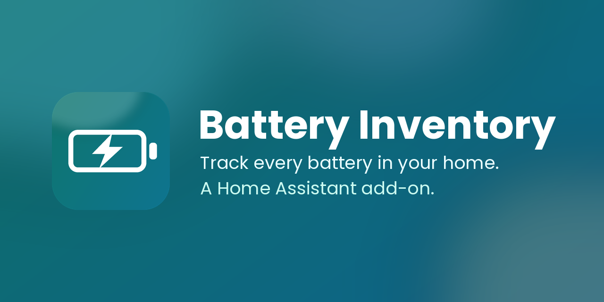

  

# 🔋 Battery Inventory

**Garde la trace de toutes les piles de ta maison.** Battery Inventory est un module (add-on) Home Assistant qui sait quel équipement
utilise quelles piles, combien il t'en reste, lesquelles sont mortes, lesquelles changer bientôt, et combien de temps elles tiennent
vraiment dans chaque appareil.

[🇬🇧 English version](README.md)

## Fonctions

- **Équipements** avec photo, emplacement, catégorie, format et type de piles (standard ou rechargeable).
- **Stock** par format avec seuil d'alerte. Remplacer des piles les retire du stock ; les rechargeables remplacées passent « en recharge ».
- **Piles mortes** : une cellule rouge en haut de la page montre d'un coup d'œil ce qui demande ton attention.
- **Rappels** pour les équipements à changer à date fixe (détecteurs de fumée, serrures) : tous les 3, 6, 12 ou 24 mois.
- **Annuler** pour chaque modification (30 étapes, conservées après un redémarrage).
- **Durée de vie** de chaque équipement et **estimation annuelle d'achat** par format, calculées à partir de ton historique.
- **Entités Home Assistant** créées automatiquement via MQTT : capteurs, interrupteurs et boutons, pour tes tableaux de bord et
  automatisations, et pour remplacer des piles depuis Home Assistant.
- **Interface moderne** « verre liquide », clair et sombre, pensée pour le téléphone et l'ordinateur.
- **Local et privé** : tes données restent dans Home Assistant (elles font partie de ses sauvegardes). Aucun compte, aucun cloud.

## Installation

**Prérequis :** Home Assistant OS ou Supervised (avec la boutique de modules). Pour les entités Home Assistant, le module
**Mosquitto broker** (ou un autre broker MQTT) ; l'appli fonctionne aussi sans.

1. Clique sur le bouton ci-dessus, ou va dans **Paramètres → Modules complémentaires → Boutique → ⋮ → Dépôts** et ajoute  
   `https://github.com/demeule/ha-Battery-Inventory`
2. Installe **Battery Inventory** (la première installation construit le module et demande internet : compte une à deux minutes).
3. Active **Démarrer au démarrage** et **Afficher dans la barre latérale**, puis **Démarrer**.
4. Ouvre **Batteries** dans la barre latérale. Au premier lancement, des exemples s'affichent : un seul tap pour les effacer.

L'appli fonctionne aussi dans l'application mobile Home Assistant, et depuis l'extérieur via ton adresse Home Assistant habituelle.

## Entités Home Assistant

Voir le tableau (en anglais) dans le [README](README.md#home-assistant-entities). Les noms des entités commencent par `battery_`.
L'état de la liaison MQTT est visible dans l'appli, dans **Paramètres → Liaison avec Home Assistant**.

## Données et sauvegardes

Tout est gardé dans le dossier de données du module : il est donc inclus dans les sauvegardes Home Assistant. L'appli garde aussi une
copie par jour pendant 14 jours. **Paramètres → Sauvegarde** permet de télécharger ou de restaurer un fichier contenant toutes tes
données, photos comprises.

## Contribuer et soutenir

Les idées, signalements de problèmes et contributions sont les bienvenus : voir [CONTRIBUTING.md](CONTRIBUTING.md).
Le projet est libre et gratuit ; si tu veux le soutenir : ⭐ une étoile sur le dépôt, ou ☕ [un café sur Ko-fi](https://ko-fi.com/demeule).

## Licence

[MIT](LICENSE). Projet communautaire indépendant, sans lien avec Home Assistant ni Nabu Casa.
