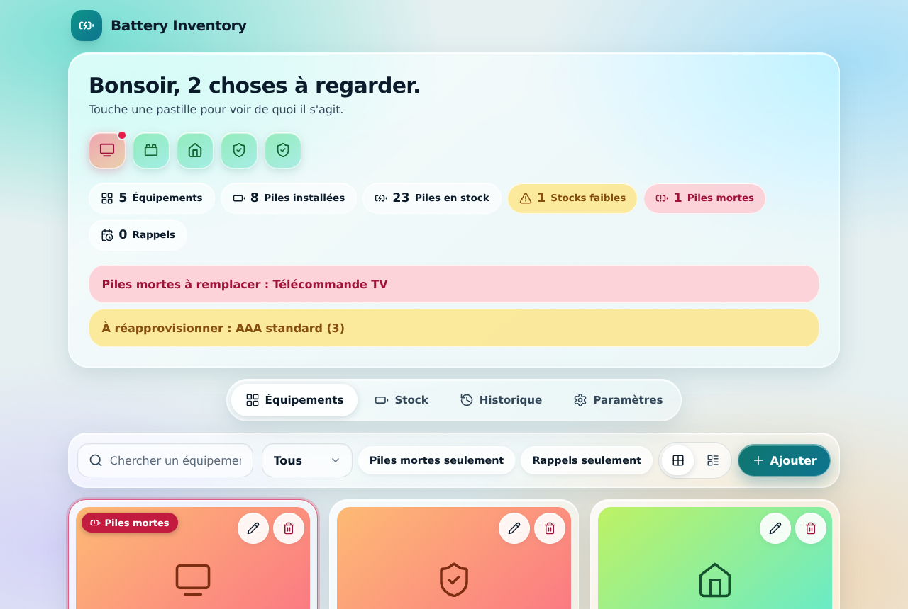
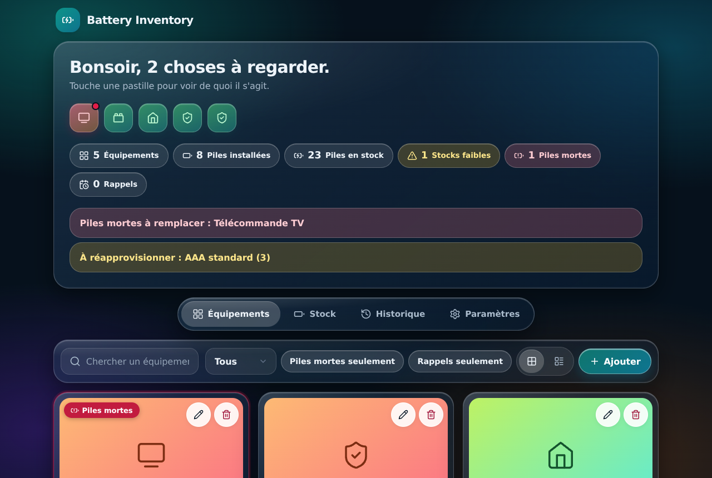
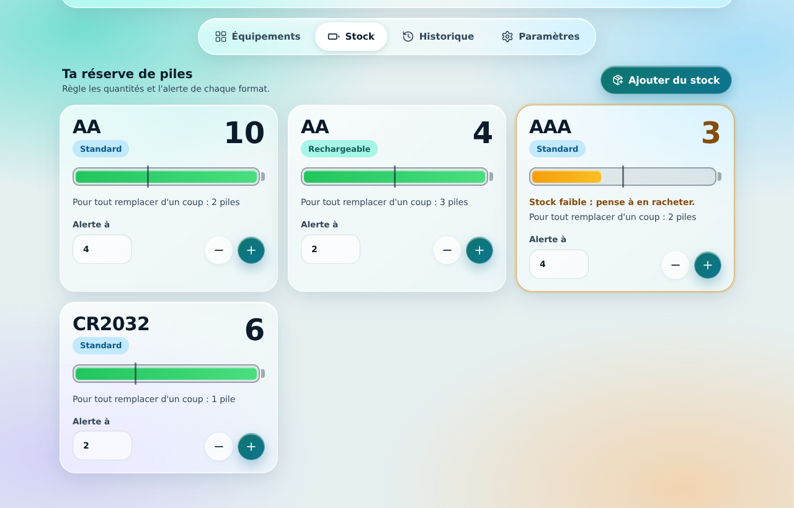
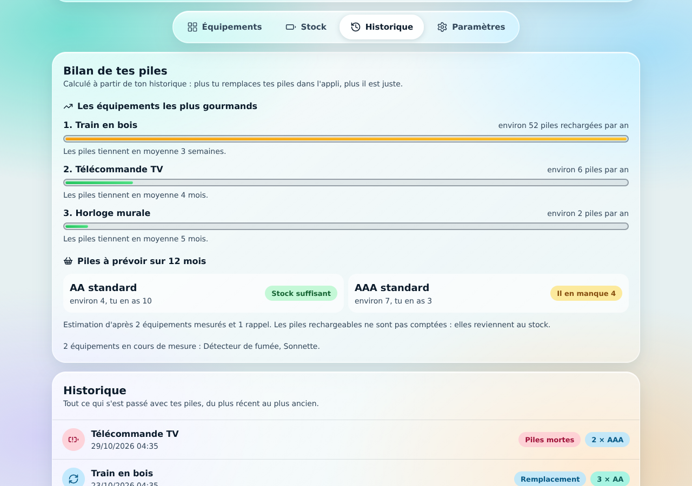
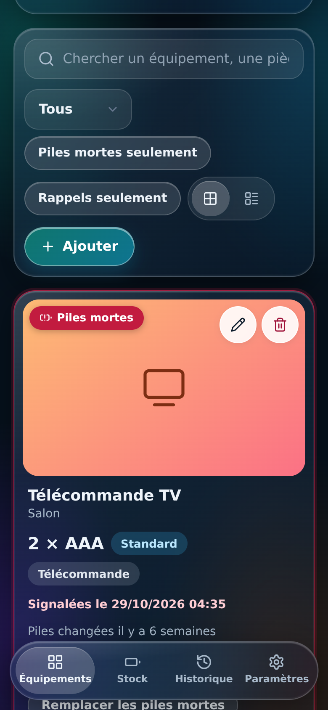
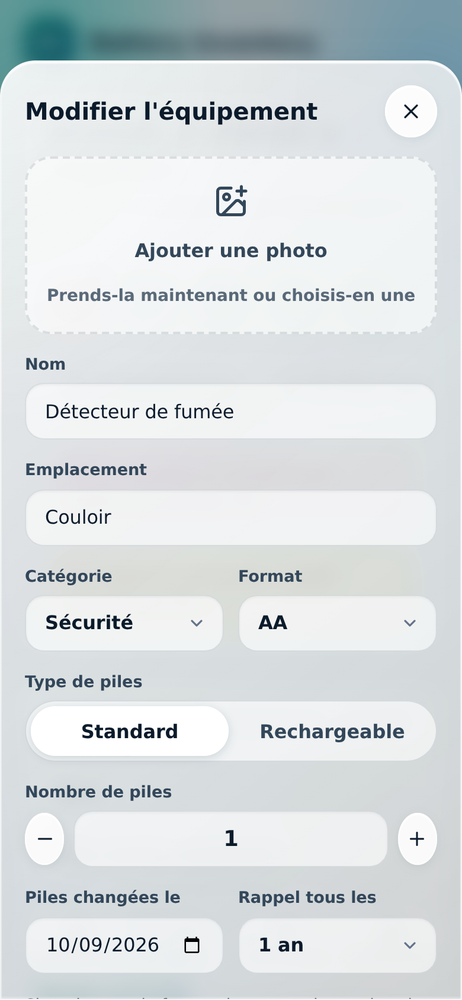

<p align="center">
  
</p>

# 🔋 Battery Inventory

[](https://github.com/demeule/ha-Battery-Inventory/actions/workflows/tests.yml)
[](LICENSE)
[](#installation)

**Track every battery in your home.** Battery Inventory is a Home Assistant add-on that knows which equipment uses which batteries,
how many you have left, what is dead, what should be replaced soon, and how long batteries really last for each device.

[🇫🇷 Version française](README.fr.md)

> **Language:** the interface is currently in **French**. An English interface is on the [roadmap](#roadmap), and translations are welcome.

[](https://my.home-assistant.io/redirect/supervisor_add_addon_repository/?repository_url=https%3A%2F%2Fgithub.com%2Fdemeule%2Fha-Battery-Inventory)

## Features

- **Equipment** with photo, location, category, battery format and type (standard or rechargeable).
- **Stock** per format with an alert threshold. Replacing batteries takes them out of the stock; replaced rechargeable batteries go "in charge" and come back when you say so.
- **Dead batteries** flag, with a red cell at the top of the page so you see at a glance what needs attention.
- **Reminders** for equipment that must be changed on a schedule (smoke detectors, locks): every 3, 6, 12 or 24 months.
- **Undo** for every change (30 steps, kept across restarts), with an *Undo* button right after each action.
- **Lifetime estimates** per equipment and a **yearly shopping estimate** per format, computed from your own history (nothing is guessed before there is enough data).
- **Home Assistant entities** created automatically through MQTT: sensors, switches and buttons, so you can build dashboards and automations, and replace batteries from Home Assistant.
- **Modern interface**: liquid-glass look, light and dark, built for phone and desktop.
- **Private and local**: your data stays in Home Assistant (included in its backups). No account, no cloud, no tracking.

## Screenshots

<p align="center">
  
  
</p>
<p align="center">
  
  
</p>
<p align="center">
  
  
</p>

## Installation

**Requirements:** Home Assistant OS or Supervised (anything that has the *Add-on store*). For the Home Assistant entities, the
**Mosquitto broker** add-on (or any MQTT broker); the app itself works without it.

1. Click the button above, or go to **Settings → Add-ons → Add-on store → ⋮ → Repositories** and add  
   `https://github.com/demeule/ha-Battery-Inventory`
2. Install **Battery Inventory** (the first install builds the add-on and needs internet access; it takes a minute or two).
3. Turn on **Start on boot** and **Show in sidebar**, then **Start**.
4. Open **Batteries** in the sidebar. The first launch shows example data you can erase with one tap.

The app also works in the Home Assistant mobile app, and from outside your home through your usual Home Assistant address.

## Home Assistant entities

Created automatically when the add-on is connected to your MQTT broker (no YAML to write). The add-on's **Settings** page in the
app shows the connection status.

| Entity | What it is |
|---|---|
| `sensor.battery_total_stock`, `sensor.battery_total_installed`, `sensor.battery_equipment_count` | Totals |
| `sensor.battery_low_stock_count`, `binary_sensor.battery_low_stock_alert` | Formats under their threshold (attribute `text` lists them) |
| `sensor.battery_dead_count`, `binary_sensor.battery_dead_alert` | Equipment with dead batteries (attribute `text`) |
| `sensor.battery_reminder_count`, `binary_sensor.battery_reminder_alert` | Replacement reminders due soon or overdue (attribute `text`) |
| `sensor.battery_last_result` | Result of the last command sent from Home Assistant (attribute `ok`) |
| One device per equipment: `switch.battery_<name>_dead`, `button.battery_<name>_replace`, `binary_sensor.battery_<name>_reminder` | Flag dead batteries, replace them, see the reminder |
| Device *Battery stock*: `sensor.battery_stock_<format>_<type>`, `binary_sensor.battery_stock_<format>_<type>_low`, … | Stock per format, "in charge" count, *charge finished* button |

A ready-made dashboard card is in [`docs/dashboard-card.yaml`](docs/dashboard-card.yaml).

Example automation: notify when a format runs low.

```yaml
triggers:
  - trigger: state
    entity_id: binary_sensor.battery_low_stock_alert
    to: "on"
actions:
  - action: notify.mobile_app_YOUR_PHONE   # replace with your own notify service
    data:
      title: "Batteries to buy"
      message: "{{ state_attr('binary_sensor.battery_low_stock_alert', 'text') }}"
```

## Data, backups and privacy

Everything is stored in the add-on data folder, so it is part of Home Assistant backups. The app also keeps one copy per day for
14 days. **Settings → Sauvegarde** downloads or restores a file with all your data, photos included. The server only accepts
requests coming from the Home Assistant proxy; nothing is sent anywhere else.

## Run without Home Assistant

```bash
python battery_inventory/server.py --ouvrir
```

Needs only Python 3.10+. Opens `http://localhost:8765`. See [CONTRIBUTING.md](CONTRIBUTING.md).

## Roadmap

- English interface (and an easy way to add other languages), with entity names following the chosen language.
- Optional notifications for reminders and low stock.
- Barcode or NFC tag to log a replacement in one tap.

Ideas and votes are welcome in [Discussions](https://github.com/demeule/ha-Battery-Inventory/discussions).

## Contributing

Bug reports, ideas and pull requests are welcome: see [CONTRIBUTING.md](CONTRIBUTING.md). Please use the issue templates.

## Support the project

Battery Inventory is free and open source. If it saves you from a dead remote at the wrong moment, you can say thanks:

- ⭐ star the repository,
- ☕ [buy me a coffee on Ko-fi](https://ko-fi.com/demeule).

## License

[MIT](LICENSE). Third-party components are listed in [THIRD_PARTY_NOTICES.md](THIRD_PARTY_NOTICES.md).

*This is an independent community project. It is not affiliated with or endorsed by Home Assistant or Nabu Casa.*
